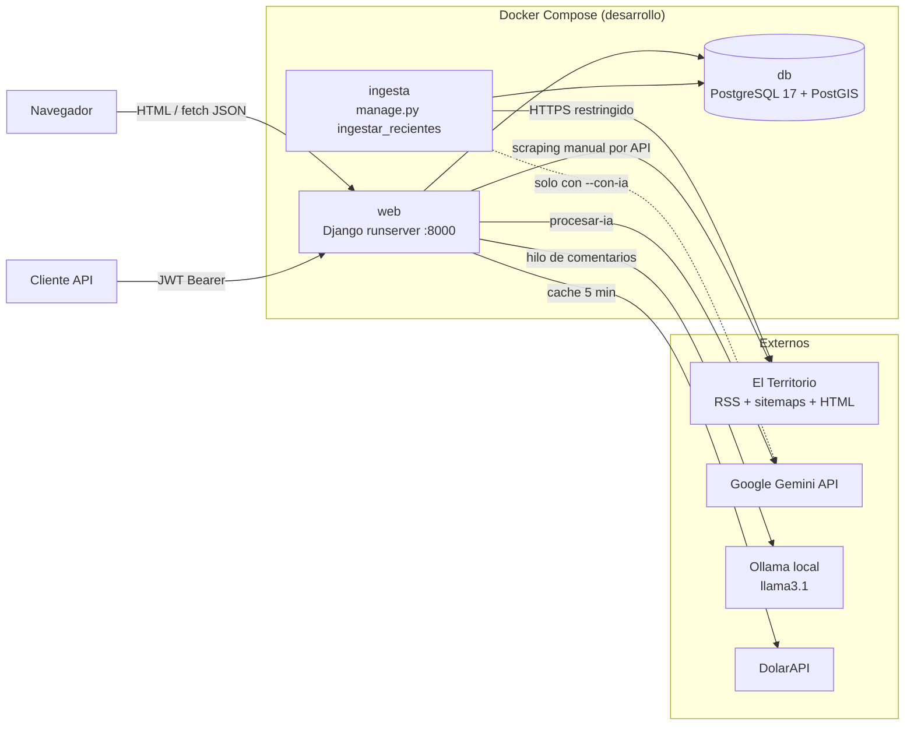
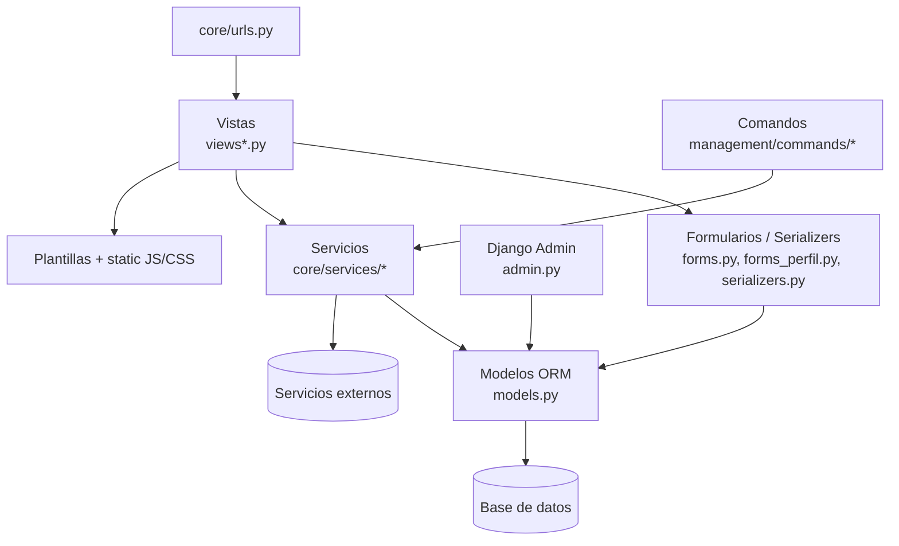
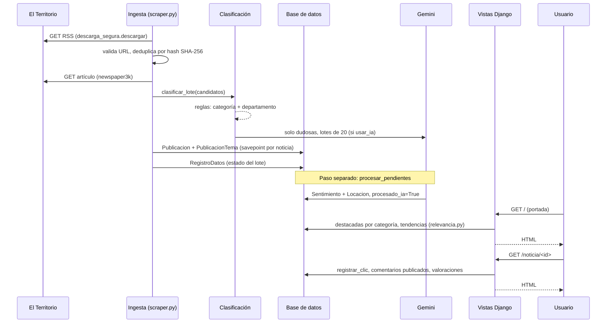

# 02 — Descripción, objetivos, arquitectura y stack

## 1. Finalidad y objetivos

**Finalidad:** monitorear la cobertura periodística de Misiones (fuente: El Territorio) para mostrar
noticias por tema y territorio, su tono (sentimiento) y la participación de los lectores.

**Objetivos principales** (derivados del código y de los 20 requisitos de `docs/trazabilidad-requisitos.md`):

- Recolección automática y almacenamiento histórico de publicaciones (requisitos 1.0 y 1.2).
- Clasificación por categoría, localidad, fecha y fuente (2.2 y 3.2).
- Análisis de sentimiento (2.3).
- Gestión de usuarios con roles (3.0).
- Búsqueda y filtrado (3.2.1), indicadores (3.1), mapas y distribución geográfica (3.1.2).
- API REST (4.3).

**Objetivos secundarios o planificados sin implementar en el código:** resúmenes e insights con IA (2.0 y
2.1), reportes periódicos (3.1.3), alertas por relevancia (3.1.4), temas emergentes en tiempo real (4.0),
comparación entre localidades (4.1) y predicción (4.2). El estado de cada uno está en
[04](04_modulos_y_funcionalidades.md).

## 2. Arquitectura

El sistema es un **monolito Django** con una sola aplicación de dominio (`core`). No hay colas externas
(Celery, RQ), ni servicios separados ni un frontend SPA. Los procesos de fondo son:

- **comandos de gestión** (`manage.py <comando>`), incluido un bucle de ingesta en un contenedor aparte;
- un **hilo trabajador en memoria** dentro del proceso web, que analiza los comentarios.

### Capas internas de `core`

La regla de diseño declarada en `AGENTS.md` ("keep external-service logic in service modules") se cumple
en general. La excepción es `core/services/gemini_cliente.py`, que además define una vista HTTP
(`disparar_ingesta`) no enrutada (ver [11](11_problemas_y_recomendaciones.md)).

## 3. Recorrido de los datos (origen → presentación)

## 4. Stack tecnológico

| Capa | Tecnología | Versión / fuente | Uso real verificado |
|---|---|---|---|
| Lenguaje | Python | 3.13 (`Dockerfile`), ≥3.12 local (README) | Sí |
| Framework web | Django | 6.1.2 (`requirements.txt`) | Sí |
| API | Django REST Framework | 3.18.3 | Sí (vistas `@api_view`, `APIView`) |
| Autenticación API | djangorestframework-simplejwt + `token_blacklist` | 5.5.1 | Sí |
| BD producción y desarrollo | PostgreSQL | imagen `postgis/postgis:17-3.5` | Sí (driver `psycopg2-binary` 2.9.13) |
| Extensión GIS | PostGIS | 3.5 en la imagen | **No usada**: sin `django.contrib.gis` ni campos geográficos |
| BD alternativa | SQLite | `app/db.sqlite3` (0 bytes en disco) | Si `DB_HOST` está vacío |
| Configuración | python-dotenv | 1.2.4 | Sí, excepto en producción |
| IA en la nube | google-genai | 2.29.0 | Sí; modelo por defecto `gemini-3.8-flash` |
| IA local | Ollama (HTTP `/api/generate`) | no es dependencia Python | Sí, vía `httpx` |
| Cliente HTTP | httpx | transitiva de google-genai | Sí (Ollama y errores de Gemini) |
| Extracción de artículos | newspaper3k + lxml_html_clean | 0.2.8 / 0.4.5 | Sí |
| Cálculo numérico | numpy | 2.5.3 | Sí (`sentimiento.py`) |
| — | pandas 3.0.6, scipy 1.18.1, feedparser 6.0.14 | `requirements.txt` | **No importadas en el código** |
| Servidor producción | gunicorn | 23.0.0 (`requirements-production.txt`) | `Dockerfile.production` |
| Frontend | Plantillas Django, CSS, JavaScript sin framework | `app/static/` | Sí |
| Pruebas JS | Node `node:test` | — | `app/core/test_auth_flow.js`, `tools/*` |
| Contenedores | Docker Compose v2 | `docker-compose.yml`, `compose.production.yml` | Sí |
| Diagrama ER | draw.io | `drawio/ENTIDADRELACION.drawio` | Material de referencia |

## 5. Servicios externos e integraciones

| Servicio | Módulo | Autenticación | Notas |
|---|---|---|---|
| El Territorio (`elterritorio.com.ar`, `www.`) | `services/descarga_segura.py` | Ninguna | Solo HTTPS, lista blanca de hosts, IP pública validada, ≤8 MB, ≤6 redirecciones |
| Google Gemini | `services/gemini_cliente.py`, `clasificacion.py`, `clasificacion_departamentos.py` | `GEMINI_API_KEY` | Respuestas JSON validadas campo por campo |
| Ollama | `services/sentimiento_comentarios.py` | Ninguna | `OLLAMA_BASE_URL` (por defecto `127.0.0.1:11434`; en Compose `host.docker.internal`) |
| DolarAPI | `services/cotizaciones.py` | Ninguna | Cotización oficial, blue y real (BRL), caché de 5 min o 1 min si es parcial |
| Redes sociales de El Territorio | `scraper.py` `REDES_SOCIALES` | — | Solo un diccionario de URLs. **No hay ingesta de redes sociales** |

## 6. Despliegue

- **Desarrollo:** `docker-compose.yml` con los servicios `db`, `web` (`runserver`, volumen `./app:/app`) e
  `ingesta`. La base se publica solo en `127.0.0.1:5433`.
- **Producción:** `Dockerfile.production` y `compose.production.yml`, con usuario no root 10001,
  sistema de archivos de solo lectura, `cap_drop: ALL`, gunicorn con 2 workers y timeout de 60 s, y
  `settings_production.py` validado por `production_config.py`. La base es externa. No incluye servicio de
  ingesta ni de Ollama. **NO VERIFICADO** que se haya desplegado.
- **Dev container:** `.devcontainer/devcontainer.json` usa el servicio `web` del Compose.
