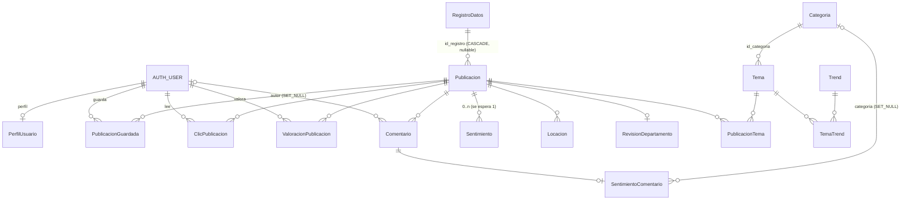

# 05 — Arquitectura de base de datos

No se consultó ninguna base de datos. Todo lo que sigue se deriva de `app/core/models.py`, las migraciones y
la configuración. El contenido real y el estado de migraciones aplicadas de cualquier base quedan
**NO VERIFICADOS**.

## 1. Motor y configuración

- **PostgreSQL** si `DB_HOST` no está vacío (`app/mi_proyecto/settings.py`, líneas 100–110). En Compose es
  la imagen `postgis/postgis:17-3.5`, publicada en `127.0.0.1:5433` del anfitrión y `db:5432` entre
  contenedores.
- **SQLite** (`app/db.sqlite3`) si `DB_HOST` está vacío. El archivo existe con 0 bytes.
- **Producción:** PostgreSQL externo con `sslmode` obligatorio y explícito (`production_config.py`).
- **Extensiones:** la imagen trae PostGIS, pero el código no la usa (no hay `django.contrib.gis` ni campos
  geométricos). Solo `medir_buscador` consulta si está instalada. No hay `pgvector`.
- **Funciones SQL específicas:** `normalize(…, NFC)`, `IS NFC NORMALIZED`, `translate`, `lower`,
  `regexp_split_to_table`, `pg_advisory_xact_lock`. En SQLite se registran funciones Python equivalentes
  (`tw_plegar_v1` en `apps.CoreConfig.ready`, `tw_palabras` en `sugerencias.py`).

## 2. Modelo entidad-relación (modelos activos)

**Categorías:** una publicación se asocia a categorías de forma indirecta (`Publicacion → PublicacionTema →
Tema → Categoria`). La clasificación automática crea o reutiliza un tema por categoría
(`clasificacion.vincular_categoria`, que elige el primer `Tema` de esa categoría).

## 3. Tablas y campos relevantes

| Modelo (tabla) | Clave primaria | Campos relevantes | Restricciones e índices |
|---|---|---|---|
| `Publicacion` (`"Publicacion"`) | `id_publicacion_api` (AutoField) | `hash_origen` (64), `fuente` (100, por defecto 'El Territorio'), `titulo` (255), `contenido`, `url` (500), `imagen_url` (500), `imagen_archivo`, `fecha_publicacion` (nullable), `departamento` (slug, 30), `fecha_captura`, `procesado_ia`, `id_registro` (FK) | `hash_origen` **UNIQUE**. Columnas generadas persistidas `titulo_busqueda` y `contenido_busqueda` (`GeneratedField`, `TextoComparableV1`). Permisos propios `ejecutar_scraping` y `procesar_ia`. El manager por defecto hace `defer` de las columnas de búsqueda |
| `RegistroDatos` (`"Registro_Datos"`) | `id_registro` | `fuentes_api`, `fecha_ejecucion`, `estado` (`EN_PROCESO`, `EXITO`, `ERROR: …`), `lenguaje` | — |
| `Categoria` (`"Categorias"`) | `id_categoria` | `nombre_categoria` (100) | **Sin UNIQUE** en el nombre |
| `Tema` (`"Temas"`) | `id_temas` | `descripcion`, `id_categoria` (FK CASCADE) | M2M con `Publicacion` y `Trend` mediante tablas intermedias |
| `PublicacionTema` (`"Publicacion_Temas"`) | `id` | `id_publicacion_api`, `id_temas` | `unique_together` |
| `Trend` (`"Trends"`) | `id_trends` | `clave` (UNIQUE, nullable, `lecturas_7_dias`), `relevancia`, `intervalos_periodo` | — |
| `TemaTrend` (`"Temas_Trends"`) | `id` | `id_temas`, `id_trends` | `unique_together` |
| `Sentimiento` (`"Sentimiento"`) | `id_sentimiento` | `polaridad`, `confianza`, `id_publicacion_api` (FK) | **Sin UNIQUE** por publicación; la unicidad se impone en el código (`integridad_sentimiento.sentimiento_unico`) |
| `Locacion` (`"Locacion"`) | `id_locacion` | `location` (18), `latitud`, `longitud`, FK publicación | — |
| `RevisionDepartamento` | `id` (BigAuto) | OneToOne publicación, `metodo` (reglas o ia), `estado` (5 valores), `departamento`, `lugar`, `evidencia` (240), `modelo`, `historial` (JSON), `fecha_revision` | OneToOne |
| `Comentario` | `id` | `publicacion` (CASCADE), `autor` (SET_NULL), `texto` (2000), `estado` (pendiente, publicado o rechazado), `fecha_creacion`, `fecha_edicion` | Orden `-fecha_creacion` |
| `SentimientoComentario` | `id` | OneToOne comentario, `polaridad`, `confianza`, `metodo`, `modelo`, `texto_hash`, `categoria` (FK SET_NULL), `estado`, `codigo_error`, fechas | CHECK de rango de polaridad [-1, 1] y confianza [0, 1]. CHECK "procesado exige valores". Índice `(estado, fecha_actualizacion)` |
| `ValoracionPublicacion` | `id` | `publicacion`, `usuario`, `sentimiento` | UNIQUE `(publicacion, usuario)`; CHECK de valores válidos |
| `PublicacionGuardada` | `id` | `usuario`, `publicacion`, `fecha_creacion` | UNIQUE `(usuario, publicacion)` |
| `ClicPublicacion` | `id` | `usuario`, `publicacion`, `fecha_creacion`, `ultima_visita` | UNIQUE `(usuario, publicacion)`; índice `fecha_creacion` |
| `PerfilUsuario` | `id` | OneToOne `auth.User`, `fecha_nacimiento`, `celular` | — |
| Legacy: `Role` (`"Roles"`), `User` (`"User"`), `VotoPublicacion`, `Auditoria`, `UserAuditoria` | varios | `User.email` CharField(20), `password_hash` | Ver [04 §10](04_modulos_y_funcionalidades.md) |

Además, Django y Simple JWT crean sus propias tablas: `auth_*`, `django_session`, `django_admin_log`,
`token_blacklist_outstandingtoken` y `token_blacklist_blacklistedtoken`.

## 4. Migraciones

| Migración | Contenido | En `HEAD` |
|---|---|---|
| 0001–0002 | `Publicacion` inicial, cambio de tipo del id | Sí |
| 0003 | Crea `Categoria`, `RegistroDatos`, `Role`, `Trend`, entre otros; elimina campos antiguos de `Publicacion` (`categoria`, `insight_clave`, `localidad`…) | Sí |
| 0004 | `hash_origen`, `fuente`, `titulo`, `url`, `procesado_ia`, `fecha_captura` | Sí |
| 0005 | Permisos `ejecutar_scraping` y `procesar_ia` | Sí |
| 0006–0007 | `departamento`, `fecha_publicacion`, `imagen_url`, `imagen_archivo` | Sí |
| 0008–0010 | `Comentario`, `ValoracionPublicacion`, `PerfilUsuario`, `PublicacionGuardada` | Sí |
| 0011_sentimientocomentario | `SentimientoComentario` | Sí |
| 0012_sentimientocomentario_categoria | FK `categoria` | Sí |
| 0011_publicacion_texto_busqueda | Columnas generadas de búsqueda | **No (sin seguimiento)** |
| 0012_merge_20261027_0946 | Fusión de las dos 0011 | **No** |
| 0013 | `ClicPublicacion` | **No** |
| 0014 | `Comentario.estado` (los existentes quedan `publicado`; los nuevos, `pendiente`) | **No** |
| 0015 | RunPython: pasa a `pendiente` los comentarios publicados con lenguaje bloqueado | **No** |
| 0016 | `ClicPublicacion.ultima_visita` + RunPython que copia `fecha_creacion` | **No** |
| 0017 | `RevisionDepartamento` | **No** |
| 0018 | `Trend.clave` + RunPython que canoniza la tendencia "Lecturas / 7 días" | **No** |
| 0019_merge_categoria_sentimiento_y_trend_clave | Fusiona `0012_sentimientocomentario_categoria` y `0018` | **No (tampoco existe en `origin/main`)** |

Las migraciones de datos (0015, 0016 y 0018) tienen operación inversa `noop`: no son reversibles a nivel
de datos. Que el grafo no tenga hojas múltiples ni migraciones faltantes (`makemigrations --check`) queda
**NO VERIFICADO**, porque requiere ejecutar Django.

## 5. Posibles problemas de integridad

1. **Migraciones sin commitear.** Ver [11](11_problemas_y_recomendaciones.md), problema P1.
2. **`Sentimiento` sin restricción única.** La unicidad depende de los escritores (bloqueo
   `select_for_update` más la comprobación). Un escritor externo podría crear duplicados; el código los
   detecta como `sentimientos_multiples` y se niega a sobrescribir.
3. **`Categoria.nombre_categoria` sin UNIQUE.** `vincular_categoria_por_nombre` y
   `_categoria_por_nombre` hacen `filter().first()` y luego `create()`; dos ingestas concurrentes podrían
   crear categorías duplicadas.
4. **`Publicacion.id_registro` con CASCADE.** Borrar un `RegistroDatos` borraría las publicaciones de ese
   lote. El admin bloquea ese borrado; el ORM y el SQL directo no.
5. **`hash_origen` con `default=""` y UNIQUE.** Una segunda publicación creada sin hash por una vía no
   prevista chocaría con la primera. Las vías conocidas (ingesta, API, panel, admin) siempre calculan el hash.
6. **Identidad distinta según el origen.** La ingesta usa SHA-256 de la URL. El alta manual usa
   SHA-256 de `url or titulo`. `scrapers/noticias.py` usa el ID numérico de la URL de El Territorio como
   **clave primaria**, lo que puede colisionar con IDs autoincrementales.
7. **`Locacion.location` de 18 caracteres.** Gemini debe recortar los nombres; `departamento_de_ubicacion`
   compensa comparando también los primeros 18 caracteres.
8. **Columnas generadas.** `busqueda_texto_v1.py` declara que su semántica no debe cambiar sin una nueva
   versión y migración de recálculo.
9. **Datos personales.** `PerfilUsuario` guarda fecha de nacimiento y celular; las tablas de blacklist
   guardan tokens. El README advierte que hay que restringir el acceso a la base y a los respaldos.
