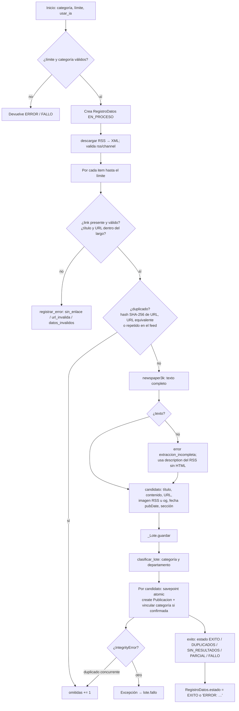

# 06 — Ingesta de noticias, procesamiento y clasificación

## 1. Fuentes

Única fuente implementada: **El Territorio** (`app/core/services/scraper.py`).

- **RSS** (`CATEGORIAS_TERRITORIO`): `misiones`, `tecnologia`, `policiales`, `cultura`, `actualidad`,
  `deportes`, `agro`, `la-region`, `pais-y-mundo`. Un comentario del código dice que al 16/10/2026
  `tecnologia` y `actualidad` se publicaban vacíos.
- **Sitemap** (`SITEMAP_TERRITORIO = https://www.elterritorio.com.ar/sitemap.xml`) para la ingesta histórica.
  Cada fecha se extrae de la URL con el patrón `/noticias/AAAA/MM/DD/<id>-`.
- **HTML del artículo**, que se descarga y procesa con `newspaper3k` para obtener el texto completo, el
  título (en la ingesta histórica), la fecha y la imagen principal.
- `REDES_SOCIALES` es solo un diccionario de URLs: **no hay ingesta de redes sociales**.

## 2. Transporte seguro (`services/descarga_segura.py`)

Todas las descargas del medio pasan por `descargar(url, timeout)`:

- Solo `https`, hosts `elterritorio.com.ar` y `www.elterritorio.com.ar`, puerto 443, sin credenciales en la
  URL, sin fragmento y sin caracteres de control (`validar_url`).
- Resuelve el DNS y **rechaza IPs no globales** (privadas, reservadas, multicast, 6to4, Teredo y
  IPv4-mapped). Luego conecta al `sockaddr` ya validado, sin volver a resolver el nombre (protege contra
  DNS rebinding).
- Hasta 6 saltos de redirección, con revalidación en cada uno. Respuesta ≤8 MB. Tiempo total limitado.
- `clave_identidad_url` define la equivalencia de URLs: esquema y host sin distinguir mayúsculas; ruta y
  query exactas.

## 3. Flujo de ingesta RSS (`fetch_and_store_elterritorio`)

**Resultado:** un diccionario con `status` (`EXITO` o `ERROR`), `estado`, `cobertura_completa`,
`disponibles`, `capturados`, `omitidas`, `errores` (link, hash, título truncado a 80 y código; nunca el
contenido), `categorias` y `sin_categoria`. Si hay más ítems que el límite, la cobertura queda incompleta
y el estado es `PARCIAL`.

**Reglas de diseño visibles en el código:**

- Los duplicados **nunca actualizan** publicaciones existentes.
- Cada noticia se guarda en su propio savepoint: un error de datos no interrumpe el lote.
- Una categoría **no confirmada** (reglas dudosas sin IA) **no se persiste**. La noticia queda sin categoría.
- Las publicaciones ingeridas quedan con `procesado_ia=False` (pendientes de Gemini).

## 4. Ingesta histórica (`ingestar_historico_elterritorio`)

1. Descarga el índice de sitemaps y cada sitemap. Un sitemap caído se registra como
   `sitemap_no_disponible` y la ingesta sigue.
2. Filtra las URLs por la fecha embebida en `[desde, hasta]`.
3. `_repartir_por_dia` alterna días, del más reciente al más antiguo, para distribuir el límite a lo largo
   del período.
4. Descarga cada artículo con una pausa (`pausa=0.5` s por defecto) "para no saturar el sitio del medio".
5. Si el artículo no trae fecha, usa el día de la URL a las 12:00 UTC. `fechas.datos_fecha` presenta las
   notas de archivo con precisión de día.
6. Las fuentes se guardan como `"El Territorio (Archivo)"`.

## 5. Ejecución automática

| Mecanismo | Detalle |
|---|---|
| `ingestar_recientes` | `while True`: recorre los 9 feeds con `limit=200` y `usar_ia=--con-ia` (falso por defecto), duerme hasta completar 300 s. Un feed caído no detiene el ciclo. |
| Servicio Compose `ingesta` | `command: python manage.py ingestar_recientes`, `restart: unless-stopped`. En el **archivo local** usa `DB_HOST: localhost` (en `origin/main`, `db`), lo que dentro del contenedor apunta al propio contenedor |
| `run_pipeline` | Ingesta de una categoría seguida de `procesar_publicaciones_con_ia(batch_size=10)` |
| API `/api/publicaciones/ingestar/<categoria>/` | Ingesta y Gemini dentro de la petición HTTP (ver el problema de tiempos en [11](11_problemas_y_recomendaciones.md)) |

No hay cron, Celery ni scheduler. La ingesta con IA no está programada por defecto.

## 6. Clasificación por categoría (`services/clasificacion.py`)

1. **Sección del medio** (`SECCION_A_CATEGORIA`): por ejemplo, `policiales` → Policiales y `agro` →
   Economía. Si hay coincidencia directa, la categoría es **segura**.
2. **Palabras clave** (`PALABRAS_CLAVE`, raíces normalizadas sin tildes): las del título pesan 3 y las del
   cuerpo, 1. Es **segura** si la ganadora aparece en el título, tiene puntaje ≥3 y al menos duplica a la
   segunda. Sin coincidencias, propone `Sociedad` como **no segura**.
3. **Gemini, solo para las dudosas** y solo si `usar_ia=True`: lotes de hasta 20 noticias, contenido
   recortado a 700 caracteres, `temperature=0.1` y respuesta JSON validada (sin claves duplicadas, índices
   existentes, categoría dentro de la lista cerrada). Un lote inválido se descarta y esas noticias quedan
   con la propuesta de reglas **sin persistirse**.
4. **Persistencia:** `vincular_categoria_por_nombre` busca o crea la `Categoria` y el primer `Tema` de esa
   categoría, y luego crea `PublicacionTema`.

## 7. Clasificación por departamento

### 7.1 Reglas en la ingesta (`departamento_por_texto`)

- Usa el catálogo `localidades.DEPARTAMENTOS`: 17 departamentos con sus municipios, más alias como
  "capital misionera", "cataratas", "triple frontera", "moconá" y "ruinas de san ignacio".
- Exige prefijos locativos ("en", "localidad de"…) para nombres ambiguos (`_MUNICIPIOS_AMBIGUOS`: San
  Martín, San José, Guaraní, Wanda, Puerto Rico, entre otros), fechas que son nombres ("9 de Julio", "25 de
  Mayo") y palabras comunes ("Capital").
- Descarta menciones seguidas de jurisdicciones externas (otras provincias o países) y referencias de
  residencia ("oriundo de", "radicado en").
- Prioridad: cabecera del título ("Lugar: …"), luego lugares del hecho en el título, luego en la entradilla
  (hasta 3 párrafos) y por último un candidato único en todo el texto. **Se abstiene** si compiten varios
  departamentos o si el título ubica el hecho fuera de Misiones.
- Gemini **nunca** interviene en este paso.

### 7.2 Revisión posterior (`revisar_departamentos` + `clasificacion_departamentos.py`)

- Selecciona noticias con `departamento=''` en lotes de 1 a 100, avanzando por cursor (`--despues-de-id`).
- Primero reglas. Las que no se resuelven van a Gemini (lotes ≤10, pausa configurable) con un prompt que
  pide estado (`asignado`, `provincial`, `fuera`, `varios` o `sin_evidencia`), departamento, lugar y
  **evidencia literal**.
- **Validación fuerte:** el lugar debe pertenecer al catálogo y al departamento, y la cita debe aparecer
  literalmente en el texto normalizado (≥12 caracteres) e incluir el lugar. "Capital" requiere la mención
  explícita "departamento Capital". El prompt indica tratar el texto como datos no confiables.
- Por defecto **simula**. `--aplicar` guarda `RevisionDepartamento` (con historial) y el departamento solo
  si la huella SHA-256 de título y contenido no cambió durante la revisión. Nunca sobrescribe un
  departamento existente.

### 7.3 Departamento derivado de `Locacion`

Las vistas también asignan una noticia a un departamento cuando alguna de sus `Locacion` (escritas por
Gemini) coincide con un municipio o departamento (`localidades.departamento_de_ubicacion`).

## 8. Procesamiento posterior

| Paso | Dónde | Resultado |
|---|---|---|
| Sentimiento y localidades con Gemini | `GeminiCliente.procesar_pendientes` | `Sentimiento`, `Locacion`, `procesado_ia=True` |
| Sentimiento léxico | Alta manual, edición de título o contenido, `/procesar-sentimiento/` | `Sentimiento`, `procesado_ia=True` |
| Recuperación de fotos | `recuperar_imagenes` | `imagen_url` desde `og:image` o `twitter:image` |

**Observación:** el sentimiento léxico marca `procesado_ia=True`, así que las publicaciones manuales
**nunca** pasan por Gemini y no obtienen `Locacion`.

## 9. Almacenamiento y presentación

- Noticia: `Publicacion` y sus relaciones (ver [05](05_base_de_datos.md)).
- Lote: `RegistroDatos` (estado final del lote).
- Presentación: portada (`relevancia.noticias_destacadas_por_categoria`), categoría, localidad, búsqueda,
  detalle (`views.noticia`: contenido sin HTML, imagen propia o enlace `http(s)`, crédito "El Territorio"
  sin la sección) y API JSON (`listar_publicaciones`, `obtener_detalle_publicacion`,
  `publicaciones_localidad`).
- Fecha efectiva: `fecha_publicacion`, o `fecha_captura` si falta (`fechas.datos_fecha`), en la zona
  `America/Argentina/Buenos_Aires`.
