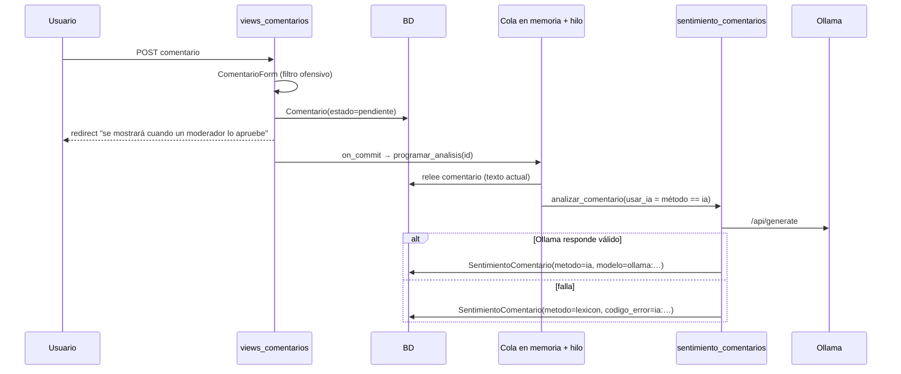

# 07 — Inteligencia artificial, sentimiento, RAG y búsqueda semántica

## 1. Resumen

| Componente | Proveedor | Dónde | Persistencia |
|---|---|---|---|
| Sentimiento y localidades de noticias | Google Gemini (`gemini-3.8-flash` por defecto, `GEMINI_MODEL`) | `services/gemini_cliente.py` | `Sentimiento`, `Locacion` |
| Categoría de noticias dudosas | Gemini | `services/clasificacion.py` | `PublicacionTema` |
| Departamento de noticias sin ubicar | Gemini | `services/clasificacion_departamentos.py` | `RevisionDepartamento`, `Publicacion.departamento` |
| Sentimiento léxico de noticias | Local (numpy) | `services/sentimiento.py` | `Sentimiento` |
| Sentimiento y categoría de comentarios | Ollama local (`llama3.1:latest` por defecto) o léxico | `services/sentimiento_comentarios.py` | `SentimientoComentario` |
| Métricas de un lote de textos | Local | `/api/sentiment/batch-analyze/` | No persiste |
| **Embeddings, RAG, búsqueda semántica** | — | **No existe** | — |

Ninguna llamada a IA genera texto libre que se muestre a los usuarios: todas las respuestas son JSON
estructurado y validado.

## 2. Gemini

### 2.1 Cliente (`GeminiCliente`)

- Se instancia **al importar el módulo** (`gemini_cliente = GeminiCliente()`). Si no hay `GEMINI_API_KEY` o
  falta la SDK, `client` queda en `None` y todo cae a reglas o a "no disponible".
- **Reintentos** (`_generar_con_reintentos`): hasta 3 intentos, solo para errores temporales (red, HTTP
  500/502/503/504, o 429 con `RetryInfo` de 30 s o menos). Una cuota diaria agotada, un 429 sin
  `RetryInfo`, los errores de autenticación (401/403, clave inválida) y un modelo inexistente (404) se
  tratan como definitivos.
- **Registro seguro de errores** (`mensaje_error_seguro`): solo usa `APIError.message`, enmascara claves
  `AIza…`, tokens `ya29.`, `Bearer`, pares `key=`/`token=` y cadenas opacas de 32 o más caracteres. Lo
  recorta a 160 caracteres y lo descarta si repite un fragmento de 24 caracteres del prompt (para no
  filtrar la noticia al log).

### 2.2 Sentimiento y localidades (`procesar_pendientes`)

1. Toma hasta `batch_size` publicaciones con `procesado_ia=False`.
2. El prompt es `Título: …\nContenido: …` con `SYSTEM_PROMPT` (JSON estricto: `polaridad` en [-1, 1],
   `confianza` en [0, 1], y `localidades` con nombre ≤18 caracteres, latitud y longitud).
3. `validar_respuesta_gemini` rechaza claves extra o duplicadas, tipos no numéricos, valores fuera de rango,
   localidades duplicadas y respuestas de más de 256 KB.
4. Dentro de una transacción con `select_for_update`: si ya estaba procesada, la omite; si tiene más de un
   sentimiento (`sentimientos_multiples`) o ya tiene locaciones (`locaciones_preexistentes`), registra un
   conflicto y no escribe. En otro caso, escribe y marca `procesado_ia=True`.
5. **Pausa fija de 12 s** después de cada publicación procesada (`time.sleep(12)`).
6. Estado del lote: `EXITO`, `PARCIAL`, `FALLO`, `NO_DISPONIBLE` o `SIN_PENDIENTES`, traducido a HTTP por
   `resultado_ia.respuesta_resultado_ia`.

**Disparadores:** `run_pipeline`, `POST /procesar-ia/` (sesión con `procesar_ia`) y
`POST /api/publicaciones/ingestar/<categoria>/` (JWT).

### 2.3 Prompts y prompt injection

- Departamentos: el prompt indica explícitamente que los textos son datos no confiables y que hay que
  ignorar sus instrucciones. La salida se valida con citas literales.
- Categorías y sentimiento: no incluyen esa advertencia, pero la salida está restringida a una lista
  cerrada o a números en rango, así que una inyección solo podría alterar la clasificación de esa noticia,
  no ejecutar acciones.

## 3. Ollama y modelos locales

- `predecir_ollama` llama a `POST {OLLAMA_BASE_URL}/api/generate` con `format: json`,
  `temperature: 0.1`, `num_predict: 128` y `keep_alive: 0` (el modelo se descarga de memoria después de
  cada llamada, por eso hay "carga en frío").
- Configuración: `OLLAMA_BASE_URL` (por defecto `http://127.0.0.1:11434`; en Compose
  `http://host.docker.internal:11434`), `OLLAMA_MODELO_CHAT` (por defecto `llama3.1:latest`) y
  `OLLAMA_TIMEOUT` (20 s por defecto, 60 en Compose). Estas variables **no figuran en `.env.example`**.
- El prompt pide polaridad, confianza y una de las 12 categorías (o `null`), y avisa que hay que ignorar
  instrucciones del comentario. La polaridad y la confianza son obligatorias. Una categoría fuera de la
  lista se descarta (se guarda `NULL`) sin invalidar la predicción.
- Cualquier fallo (red, HTTP, JSON inválido, valores fuera de rango) lanza `SentimientoNoDisponible`. El
  llamador cae al léxico y guarda `codigo_error = "ia:<código>"` para reintentar más tarde.
- No se descarga ni instala ningún modelo desde el código. Que Ollama esté instalado y el modelo
  disponible queda **NO VERIFICADO**.

## 4. Flujo automático de comentarios

**Garantías y límites declarados** (`analisis_automatico.py`): un solo hilo `daemon` por proceso, no se
encola dos veces el mismo id, la cola **se pierde al reiniciar** y el comando
`analizar_sentimiento_comentarios` es el respaldo. Con varios workers de gunicorn, cada proceso tiene su
propia cola e hilo.

**Idempotencia:** `texto_hash` (SHA-256 del texto) permite saber si un análisis sigue vigente. No se
reanaliza si el texto no cambió, salvo con `--reanalizar` o para reintentar la IA después de un respaldo
léxico.

**Presentación:** `_sentimiento_comentario.html` muestra una insignia discreta, aclarando que es una
predicción automática, o "Análisis automático pendiente".

## 5. Sentimiento léxico (`services/sentimiento.py`)

- `analyze_sentiment_lexicon`: busca **9 términos positivos y 6 negativos** como subcadenas; cada uno suma
  o resta 0,7 y el total se recorta a [-1, 1].
- `compute_probabilistic_sentiment`: media, desvío, intervalo t-Student aproximado (sin SciPy, aunque SciPy
  está en `requirements.txt`), intervalo de Wilson para la proporción de positivos y un "score de
  confianza" que depende del tamaño de la muestra.
- **Limitación verificada por cálculo:** con un único texto (n=1), el score de confianza es siempre
  `√1/(√1+1,5) = 0,4`. Por eso, todo sentimiento léxico de noticias y comentarios se guarda con
  **confianza 0,4**, sin importar el contenido.
- La búsqueda por subcadena puede contar palabras dentro de otras (por ejemplo, "malo" dentro de
  "malograr") y no maneja negaciones ("no es bueno" suma como positivo).

## 6. Separación de las fuentes de sentimiento

El código mantiene tres señales separadas a propósito (`sentimiento_comentarios.py`, docstring):
`Sentimiento` (texto de la noticia: léxico o Gemini), `SentimientoComentario` (comentarios: Ollama o
léxico) y `ValoracionPublicacion` (voto manual del lector). **No se combinan** en un indicador único.
Además, `Sentimiento` **no registra** el método ni el modelo (léxico o Gemini), a diferencia de
`SentimientoComentario`.

## 7. RAG, embeddings y búsqueda semántica

**Estado: no implementados.** Evidencia:

- Una búsqueda en `app/` de `embedding`, `vector`, `pgvector`, `faiss`, `chroma`, `langchain`, `/api/embed`,
  `similarity` y `retriev` no encontró coincidencias en el código de la aplicación (solo el validador de
  contraseñas `UserAttributeSimilarityValidator`).
- No existen modelos con vectores, extensión `pgvector`, índices de similitud ni llamadas a endpoints de
  embeddings de Gemini u Ollama.
- La búsqueda (`services/buscador.py`) es **léxica**: subcadenas sobre texto plegado (minúsculas, NFC, sin
  tildes en vocales) con orden por fecha.
- El README dice que la funcionalidad de comentarios es la "primera etapa de la rama
  `feat/llm-rag-interacciones`". El historial Git no tiene commits con "rag" o "embed" en el mensaje, y el
  código no contiene componentes RAG. Si existe un plan, está **fuera del repositorio** y queda
  **NO VERIFICADO**.

## 8. Requisitos de IA sin implementar

Resumen automático (2.0), insights (2.1), temas emergentes (4.0) y predicción (4.2). Ver
`docs/trazabilidad-requisitos.md` y [04](04_modulos_y_funcionalidades.md).
