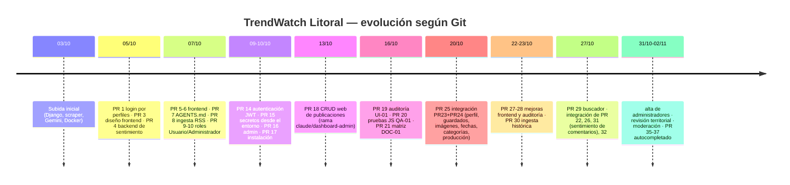

# 10 — Git, trazabilidad y evolución del proyecto

Solo se usaron comandos de lectura (`status`, `log`, `branch`, `rev-list`, `show`, `cat-file`,
`hash-object`, `worktree list`, `stash list`). No se hizo `fetch`, `pull`, `push`, `merge`, `rebase` ni
`checkout`. Las referencias remotas reflejan el **último fetch local**, cuya fecha no se conoce.

## 1. Repositorio y ramas

- **Remoto:** `origin` → `https://github.com/MakkiGan666/Trend-Watch-Litoral.git`.
- **Rama actual:** `feat/analisis-automatico-comentarios` en `bab5a3f`, sin rama remota de seguimiento.
- **Divergencia con `origin/main` (`e412f41`, 02/11/2026):** HEAD está 2 commits por delante (`6b8f462`,
  `bab5a3f`) y 22 por detrás. Merge-base: `642084e`.
- **`main` local:** `17bf180`, 60 commits por detrás de `origin/main`.
- **Commits:** 114 alcanzables desde HEAD, 134 desde `origin/main`, 147 en todas las referencias.
- **Ramas locales:** `claude/dashboard-admin`, `docs/pr7-instalacion`,
  `feat/analisis-automatico-comentarios`, `feat/llm-rag-interacciones` (3 por detrás de su remota),
  `fix/fase-3-ingesta-historico`, `fix/pr31-correcciones-auditadas`, `fix/pr5-seguridad`,
  `fix/pr5-seguridad-config`, `fix/pr6-django-admin`, `integ/pr31-con-main`,
  `integ/pr31-sobre-main-e412f41` y `main`.
- **Ramas remotas:** 34 (sin contar `origin/HEAD`), con prefijos `feat/`, `fix/`, `docs/`, `test/`, `feature/`, `chore/`, `claude/` y
  `codex/`.
- **Worktrees adicionales:** 4, ubicados en un directorio temporal de una sesión anterior de un asistente
  (`C:\Users\sofia\AppData\Local\Temp\claude\…\scratchpad\wt-feat`, `wt-integ`, `wt-integ2`, `wt-main`).
  Si ese directorio temporal se borra, quedan referencias huérfanas (se limpian con `git worktree prune`).
- **Stashes:** `stash@{0}` (23/10, sobre `fix/fase-3-ingesta-historico`: "Mis cambios locales Fase 3") y
  `stash@{1}` (09/10, sobre `main`: "wip auth + config (contiene clave, no aplicar settings/compose)").

## 2. Estado del árbol de trabajo (crítico)

| Grupo | Cantidad | Detalle |
|---|---|---|
| Rastreados modificados | 50 | 31 son **idénticos byte a byte a `origin/main`**; 19 difieren de HEAD y de `origin/main` |
| Sin seguimiento | 82 | 76 son **idénticos a `origin/main`**; 2 difieren (`services/clasificacion_departamentos.py`, `test_gestion_administradores.py`); 4 no existen en `origin/main` (`migrations/0019_merge_…`, `test_gemini_errores.py`, `diff_gemini.txt`, `grep.exe.stackdump`) |

**Interpretación:** alguien trajo al árbol de trabajo el contenido de `origin/main` (buscador,
administradores, revisión territorial, lecturas, moderación) sin hacer un merge de Git, y lo combinó con
cambios propios. Los 19 archivos que difieren de ambas versiones contienen ese trabajo propio:

```
README.md, docker-compose.yml, docs/sentimiento-comentarios.md, test_ingesta.py,
app/core/models.py, views.py, views_comentarios.py, views_dashboard.py,
services/gemini_cliente.py, services/scraper.py, services/sentimiento_comentarios.py,
templates/base.html, templates/inicio.html, templates/core/dashboard.html,
test_analisis_automatico.py, test_indicadores_inicio.py, test_navegacion_admin.py,
test_new_dashboard.py, test_sentimiento_comentarios.py
```

Más `0019_merge_categoria_sentimiento_y_trend_clave.py` y `test_gemini_errores.py`, que son nuevos. La
autoría de estos cambios sin commitear **no se puede atribuir** con Git.

**Consecuencia:** `HEAD` solo contiene las migraciones 0001–0012 (incluidas `0011_sentimientocomentario` y
`0012_sentimientocomentario_categoria`), mientras que el `models.py` del árbol depende de 0011–0019. La
rama **local** `integ/pr31-con-main` (`239915e`, "unir 0011 del buscador y del sentimiento de
comentarios"), sin publicar en el remoto y con un worktree temporal, parece un intento previo de esta misma
integración.

## 3. Autoría (según Git)

| Identidad de autor en commits | Commits (todas las ramas) | Sin merges en `origin/main` |
|---|---|---|
| Thomas Gudiño | 50 | 40 |
| Sebastian | 49 | 44 |
| SebasTech | 26 | 3 (la mayoría de sus commits son merges de PR en GitHub) |
| Sof-0007 | 22 (20 + 2 con otro email) | 12 |

- "Sebastian" y "SebasTech" pueden ser la misma persona con dos identidades, pero Git **no lo
  demuestra**. Queda **NO VERIFICADO**.
- **Herramientas de asistencia:** 9 commits de Sof-0007 llevan `Co-Authored-By: Claude Opus 5.5`
  (por ejemplo, `32ae783`, `a941b10`, `6b8f462`, `bab5a3f`). Los nombres de rama `claude/dashboard-admin` y
  `codex/…` sugieren el uso de asistentes de IA. Se registran como **herramientas**, no como autores.
- **Responsable funcional:** `docs/trazabilidad-requisitos.md` menciona a "el responsable" y asigna CAT-01
  a "Sebastián". Fuera de eso, el repositorio no contiene información verificable de roles del equipo.
- Autor del commit inicial (`5ece768`, 03/10/2026, "Subida inicial del proyecto (SC)"): Sebastian.

## 4. Evolución (pull requests fusionados en `origin/main`)



**Cambios arquitectónicos relevantes:**

1. `0003`/`0004` (03/10): rediseño de `Publicacion` (se eliminan `categoria`, `insight_clave` y
   `localidad`; se introduce `hash_origen`).
2. PR 14 (09/10): JWT con blacklist; PR 15: configuración por variables de entorno.
3. PR 9/10 (07/10): roles reducidos a Usuario y Administrador (Lector y Analista quedan históricos).
4. PR 25 (20/10): configuración de producción separada (`settings_production`, `production_config`).
5. PR 30 (23/10): ingesta histórica por sitemaps y transporte seguro.
6. PR 29 (27/10): columnas generadas y búsqueda normalizada.
7. 27/10–02/11: sentimiento de comentarios con Ollama (PR 31), moderación, lecturas y tendencias,
   revisión territorial con IA, alta de administradores.

Los números de PR provienen de los mensajes de merge. Su descripción en GitHub **no se consultó** (no se
accedió a la red).

## 5. Diferencias relevantes entre ramas

- `origin/main` incluye buscador, autocompletado, administradores, revisión territorial, lecturas,
  moderación y la ingesta periódica (servicio `ingesta` con `DB_HOST: db`). HEAD no los incluye en sus
  commits, aunque sí están en el árbol de trabajo.
- HEAD incluye `6b8f462` (respaldo de Ollama completo y preservación del análisis vigente) y `bab5a3f`
  (análisis automático de comentarios en segundo plano), que **no están en `origin/main`**.
- `origin/feat/llm-rag-interacciones` (`2407d21`) fusionó el PR 32 (`fix/pr31-correcciones-auditadas`).
  Su contenido es de sentimiento de comentarios, no de RAG.
